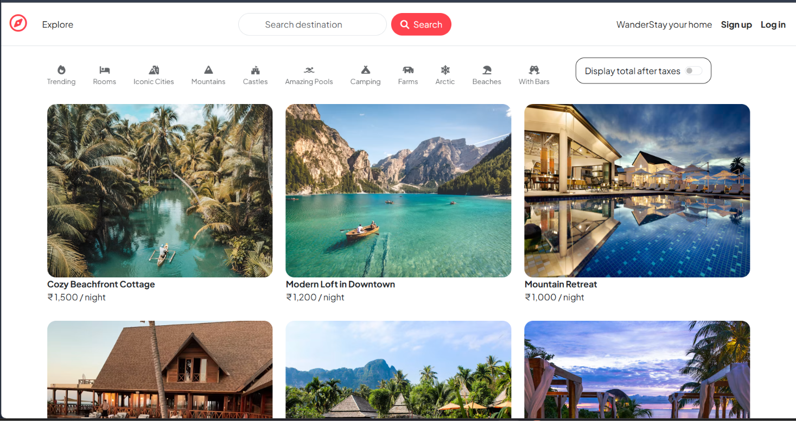
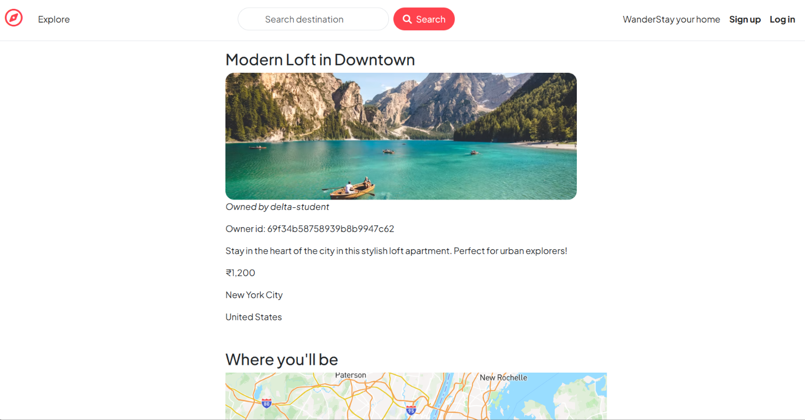

# 🏡 WanderStay — Find Your Next Getaway

**A full-stack accommodation listing platform built with Node.js, Express.js, MongoDB, and EJS.**

WanderStay is a web application inspired by vacation rental platforms, designed to help users explore accommodation listings, discover destinations, and share their experiences through reviews and ratings.

The project focuses on building a complete web application with server-side rendering, user authentication, listing management, image uploads, and interactive map integration.

---

## 📸 Project Preview

### 🏡 Explore Stays



### 🗺️ Stay Details



---

## ✨ Key Features

### 🏠 Accommodation Listings
- Browse available accommodation listings.
- View listing details, descriptions, prices, and locations.
- Create, edit, and delete listings with appropriate ownership checks.

### 🔐 Authentication & Authorization
- User registration and login using Passport.js.
- Session-based authentication.
- Access control for protected listing operations.

### ⭐ Reviews & Ratings
- Submit ratings and comments for listings.
- Display reviews with reviewer information.
- Validate review submissions on the server.

### 🗺️ Interactive Maps
- Integrate Mapbox to visualize listing locations.
- Display map markers and listing information.
- Show approximate property locations on the map.

### ☁️ Image Management
- Integrate Cloudinary for image storage.
- Use Multer and Cloudinary Storage to handle image uploads.

### 🎨 Responsive User Interface
- Server-rendered pages using EJS.
- Reusable layouts and partial templates.
- Styled listing cards, navigation, and forms.

---

## 🛠️ Tech Stack

| Category | Technologies |
|---|---|
| Frontend | HTML, CSS, JavaScript, EJS |
| Backend | Node.js, Express.js |
| Database | MongoDB, Mongoose |
| Authentication | Passport.js, Passport Local |
| Image Storage | Cloudinary, Multer |
| Maps | Mapbox |
| Validation | Joi |
| Session & Middleware | Express Session, Connect Flash, Method Override |
| Version Control | Git, GitHub |

---

## 🏗️ Application Architecture

WanderStay follows a structured server-side MVC-style architecture.

- **Models:** Define MongoDB document structures using Mongoose.
- **Views:** Render pages using EJS templates.
- **Controllers:** Handle listing, review, and user-related operations.
- **Routes:** Organize application endpoints.
- **Middleware:** Handle authentication, authorization, and request processing.
- **Cloud Services:** Cloudinary manages uploaded images, while Mapbox provides map functionality.

### Request Flow

```text
User / Browser
      |
      v
Express.js Routes
      |
      v
Middleware & Validation
      |
      v
Controllers
      |
      v
Mongoose Models
      |
      v
MongoDB

Express.js --> EJS Views --> HTML Response
Cloudinary  ---->  Image Storage
Mapbox      ---->  Interactive Maps

## 🚀 Getting Started

### Prerequisites

- Node.js and npm
- MongoDB or MongoDB Atlas
- A Cloudinary account
- A Mapbox public access token

### 1. Clone the Repository

```bash
git clone https://github.com/Nisha-kumari515/WanderStay.git
cd WanderStay
```

### 2. Install Dependencies

```bash
npm install
```

### 3. Configure Environment Variables

Create a `.env` file in the project root and add the variables your application requires.

```env
ATLASDB_URL=your_mongodb_connection_string
SECRET=your_session_secret
CLOUD_NAME=your_cloudinary_cloud_name
CLOUD_API_KEY=your_cloudinary_api_key
CLOUD_API_SECRET=your_cloudinary_api_secret
MAPBOX_PUBLIC_TOKEN=your_mapbox_public_token
```

Use the exact variable names referenced in your source code.

Never upload `.env` or private credentials to GitHub.

### 4. Start the Application

```bash
node app.js
```

Open the local URL printed in your terminal.

## 📂 Project Structure

```text
WanderStay/
├── classroom/
│   ├── routes/
│   │   ├── post.js
│   │   └── user.js
│   ├── views/
│   │   └── page.ejs
│   └── server.js
├── controllers/
│   ├── listings.js
│   ├── reviews.js
│   └── users.js
├── init/
│   ├── data.js
│   └── index.js
├── models/
│   ├── listing.js
│   ├── review.js
│   └── user.js
├── public/
│   ├── css/
│   │   ├── rating.css
│   │   └── style.css
│   └── js/
│       ├── map.js
│       └── script.js
├── routes/
│   ├── listing.js
│   ├── review.js
│   └── user.js
├── utils/
│   ├── ExpressError.js
│   └── wrapAsync.js
├── views/
│   ├── includes/
│   │   ├── flash.ejs
│   │   ├── footer.ejs
│   │   └── navbar.ejs
│   ├── layouts/
│   │   └── boilerplate.ejs
│   ├── listing/
│   │   ├── edit.ejs
│   │   ├── index.ejs
│   │   ├── new.ejs
│   │   └── show.ejs
│   ├── users/
│   │   ├── login.ejs
│   │   └── signup.ejs
│   └── error.ejs
├── .gitignore
├── app.js
├── cloudConfig.js
├── middleware.js
├── package.json
├── package-lock.json
└── schema.js
```

## 👩‍💻 Author

**Nisha Kumari**

Computer Science & Engineering Student | Full-Stack Developer

- GitHub: [Nisha-kumari515](https://github.com/Nisha-kumari515)
- Project Repository: [WanderStay](https://github.com/Nisha-kumari515/WanderStay)

---